

  <a href="brand/brot-animated-logo.svg">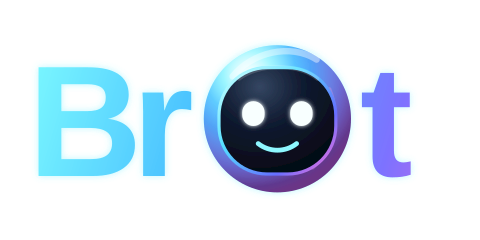</a>

# Your Bot should be called Brot

Brot = Bro + Bot. 🤖

"Your Bot" is a product. "Brot" is a personality—smart, friendly, expressive, and always ready to help. More than an assistant, it’s your bro. 

Meet the animated faces of Brot!

## Individual emotions

| Awake | Curious | Happy | Surprised |
| :---: | :---: | :---: | :---: |
| [](expressions/awake.svg) | [](expressions/curious.svg) | [](expressions/happy.svg) | [](expressions/surprised.svg) |
| [Open SVG](expressions/awake.svg) | [Open SVG](expressions/curious.svg) | [Open SVG](expressions/happy.svg) | [Open SVG](expressions/surprised.svg) |

| Focused | Tired | Confused | Angry |
| :---: | :---: | :---: | :---: |
| [](expressions/focused.svg) | [](expressions/tired.svg) | [](expressions/confused.svg) | [](expressions/angry.svg) |
| [Open SVG](expressions/focused.svg) | [Open SVG](expressions/tired.svg) | [Open SVG](expressions/confused.svg) | [Open SVG](expressions/angry.svg) |

## Expressive 3D orbs

Soft spherical characters inspired by the reference image. Their inset eyes carry most of the performance while the virtual camera pans and zooms toward each emotional peak.

| Wonder | Excited | Shy |
| :---: | :---: | :---: |
| [](expressions/orb-wonder.svg) |  | [](expressions/orb-shy.svg) |
| [Open SVG](expressions/orb-wonder.svg) | [Open SVG](expressions/orb-excited.svg) | [Open SVG](expressions/orb-shy.svg) |

| Skeptical | Sleepy | Alarmed |
| :---: | :---: | :---: |
| [](expressions/orb-skeptical.svg) | [](expressions/orb-sleepy.svg) | [](expressions/orb-alarmed.svg) |
| [Open SVG](expressions/orb-skeptical.svg) | [Open SVG](expressions/orb-sleepy.svg) | [Open SVG](expressions/orb-alarmed.svg) |

## Floating neon mascots

Rounded 3D jelly mascots with glossy black visors, luminous eyes, clean limb-free silhouettes, soft hovering motion, squash/stretch, rotation, camera pan, and zoom.

| Pink Comet · Joy | Solar Puff · Surprise | Cyan Drift · Curiosity |
| :---: | :---: | :---: |
| [](expressions/ghost-pink.svg) | [](expressions/ghost-orange.svg) | [](expressions/ghost-cyan.svg) |
| [Open SVG](expressions/ghost-pink.svg) | [Open SVG](expressions/ghost-orange.svg) | [Open SVG](expressions/ghost-cyan.svg) |

| Violet Hush · Shy | Lime Doze · Sleepy | Red Flare · Angry |
| :---: | :---: | :---: |
| [](expressions/ghost-violet.svg) | [](expressions/ghost-lime.svg) | [](expressions/ghost-red.svg) |
| [Open SVG](expressions/ghost-violet.svg) | [Open SVG](expressions/ghost-lime.svg) | [Open SVG](expressions/ghost-red.svg) |

## Realistic 3D antenna bots

Six compact robots inspired by the attached lineup, rebuilt with rounded extruded shells, glossy visors, dimensional antennas and legs, realistic highlights, and five-second character loops. Each bot animates its eyes, antenna, body rotation, leg bounce, camera pan, and zoom without a shadow base.

| Beacon · Alert | Blush · Friendly | Azure · Curious |
| :---: | :---: | :---: |
| [](expressions/antenna-beacon.svg) | [](expressions/antenna-blush.svg) | [](expressions/antenna-azure.svg) |
| [Open SVG](expressions/antenna-beacon.svg) | [Open SVG](expressions/antenna-blush.svg) | [Open SVG](expressions/antenna-azure.svg) |

| Ember · Excited | Mint · Calm | Volt · Focused |
| :---: | :---: | :---: |
| [](expressions/antenna-ember.svg) | [](expressions/antenna-mint.svg) | [](expressions/antenna-volt.svg) |
| [Open SVG](expressions/antenna-ember.svg) | [Open SVG](expressions/antenna-mint.svg) | [Open SVG](expressions/antenna-volt.svg) |

## Hey Brot!

  <a href="expressions/glass-bot-performance.svg"></a>

[Open the featured animated SVG](expressions/glass-bot-performance.svg)
